<h1 align="center">Hi 👋, I'm Eddycrack 864</h1>
<h3 align="center">Telematics Engineer from Ecuador</h3>

  

- 🔭 Currently working on [UVR5 UI](https://github.com/Eddycrack864/UVR5-UI) and [AI Cover Maker](https://github.com/Eddycrack864/AI-Cover-Maker)

- 🏠 Part of the [AI HUB](https://discord.gg/aihub) community

- 🛡️ I do **pentesting and ethical hacking** professionally. Client work stays private, but my [Hack The Box and TryHackMe writeups](https://github.com/Eddycrack864/HTB-THM-Writeups) are public

- 🌱 Always leveling up in **AI and Cybersecurity**

- 🤝 Looking for collaborators and help on [UVR5 UI](https://github.com/Eddycrack864/UVR5-UI)

- 💬 Ask me about **RVC, UVR5, Python, Gradio and pentesting**

- 📫 Reach me on **[Discord](https://discord.com/users/274566299349155851)**

- 🎮 Otaku and gamer whenever the GPU needs a break

 

<h3 align="left">⚗️ Transmutations:</h3>

| Project | What goes in → what comes out | Stars |
|:---|:---|:---:|
| **[UVR5 UI](https://github.com/Eddycrack864/UVR5-UI)** · [try it](https://huggingface.co/spaces/TheStinger/UVR5_UI) | 🎵 a song → 🎚️ separated stems, in a Gradio UI |  |
| **[AI Cover Maker](https://github.com/Eddycrack864/AI-Cover-Maker)** | 🎵 a song + 🎙️ a voice model → 🎤 a finished AI cover, in one click |  |
| **[UVR5 NO UI](https://github.com/Eddycrack864/UVR5-NO-UI)** | 📓 a Colab notebook → 🎚️ stems, no UI needed |  |
| **[HTB & THM Writeups](https://github.com/Eddycrack864/HTB-THM-Writeups)** | 🚩 a Hack The Box or TryHackMe machine → 📝 a writeup | — |

<h3 align="left">🧰 Languages and Tools:</h3>

**Languages**

**Frameworks and AI**

**Data and Deploy**

**Systems and Workflow**

<h3 align="left">📊 Stats:</h3>

  
  

<h3 align="left">🤝 Connect and support:</h3>

